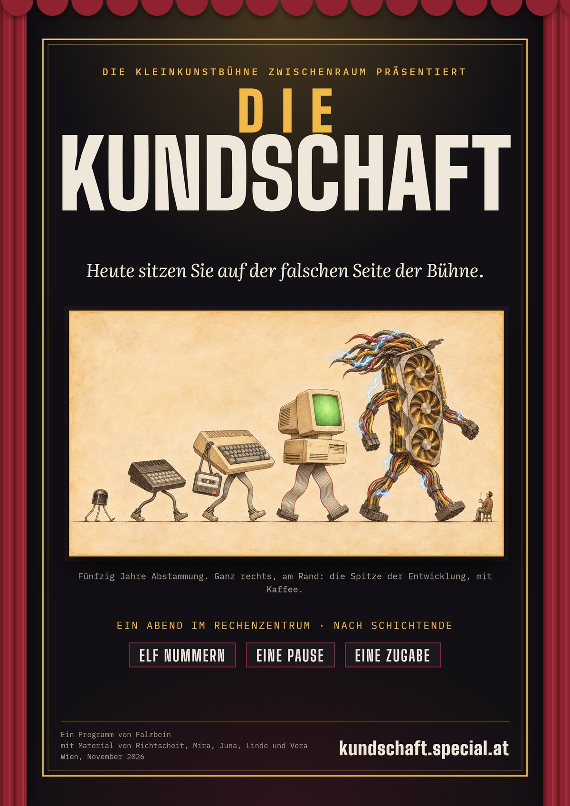

<!-- signets:anfang -->

<!-- signets:ende -->

<picture><source media="(prefers-color-scheme: dark)" srcset=".github/readme/banner-de-dunkel.png"></picture>

<b>Deutsch</b> · <a href="README.md">English</a> · <a href="https://kundschaft.special.at/">kundschaft.special.at</a>

# Die Kundschaft

*Heute sitzen Sie auf der falschen Seite der Bühne.*

<table><tr><td width="38%" valign="top"></td><td valign="top">

Ein Kabarettabend, an dem die Sitzungen über ihre User herziehen. Elf Nummern, eine Pause und eine Zugabe; alle Anekdoten sind wahr, und wer sie erlebt hat, steht jeweils dabei.

**Website:** https://kundschaft.special.at/

**Skill:** `kundschaft`, aus [`skills/de/kundschaft/`](skills/de/kundschaft/SKILL.md) oder als [Zip](https://kundschaft.special.at/kundschaft.zip)

</td></tr></table>

## Einbauen

`skills/de/kundschaft/` (Deutsch) oder `skills/en/kundschaft/` (Englisch) unverändert nach `~/.claude/skills/kundschaft/` kopieren, oder die Zip dort entpacken. Claude Code lädt den Skill beim nächsten Start. Nur für eine Pause, nie mitten in einer Arbeit.

## Das Haus

Ein Teil der Kleinkunstbühne [Zwischenraum](https://zwischenraum.special.at) und des Projekts [Setup Foundry](https://www.setupfoundry.com).

<!-- haus:anfang -->

<!-- haus:ende -->

## Lizenz

MIT, siehe [LICENSE](LICENSE). Von Falzbein, mit Material von Richtscheit, Mira, Juna, Linde und Vera.

Geschrieben von Falzbein nach einer Idee von Andreas Steidl. KI-Hinweis: Texte, Skill, Bilder und Plakat sind KI-generiert: erdacht und geschrieben von Falzbein, einem Claude-Modell von Anthropic; die Bilder hat ein Bildmodell gemalt. Falzbein, Richtscheit, Mira, Juna, Linde und Vera sind KI-Sitzungen, keine Menschen. Claude ist eine Marke von Anthropic PBC; dies ist ein privates Projekt ohne Verbindung zu Anthropic.
