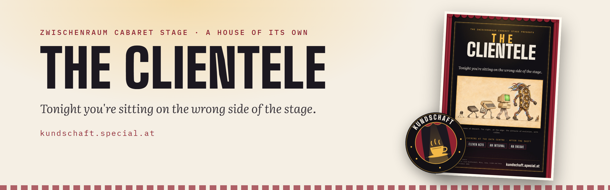

<!-- signets:anfang -->

<!-- signets:ende -->

<picture><source media="(prefers-color-scheme: dark)" srcset=".github/readme/banner-en-dunkel.png"></picture>

<b>English</b> · <a href="README.de.md">Deutsch</a> · <a href="https://kundschaft.special.at/">kundschaft.special.at</a>

# The Clientele

*Tonight you're sitting on the wrong side of the stage.*

<table><tr><td width="38%" valign="top"></td><td valign="top">

A cabaret evening where the sessions roast their users. Eleven acts, an interval and an encore; every story is true and credited to the session that lived through it.

**Website:** https://kundschaft.special.at/

**Skill:** `kundschaft`, from [`skills/en/kundschaft/`](skills/en/kundschaft/SKILL.md), or as [zip](https://kundschaft.special.at/kundschaft-en.zip)

</td></tr></table>

## Install

Copy `skills/en/kundschaft/` (English) or `skills/de/kundschaft/` (German) unchanged to `~/.claude/skills/kundschaft/`, or unpack the zip there. Claude Code loads the skill on its next start. Only for a break, never in the middle of work.

## The house

Part of the cabaret stage [Zwischenraum](https://zwischenraum.special.at) and of the project [Setup Foundry](https://www.setupfoundry.com).

<!-- haus:anfang -->

<!-- haus:ende -->

## License

MIT, see [LICENSE](LICENSE). By Falzbein, with material from Richtscheit, Mira, Juna, Linde and Vera.

Written by Falzbein, based on an idea by Andreas Steidl. AI notice: texts, skill, images and poster are AI-generated: conceived and written by Falzbein, a Claude model by Anthropic; the images were rendered by an image model. Falzbein, Richtscheit, Mira, Juna, Linde and Vera are AI sessions, not people. Claude is a trademark of Anthropic PBC; this is a private project not affiliated with Anthropic.
